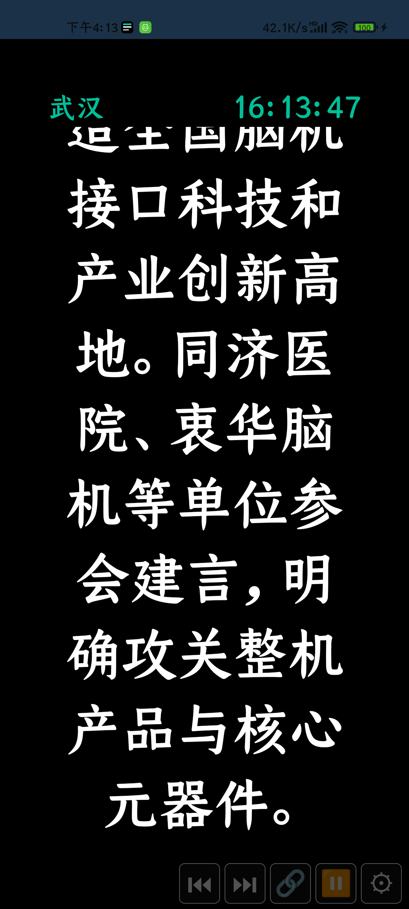
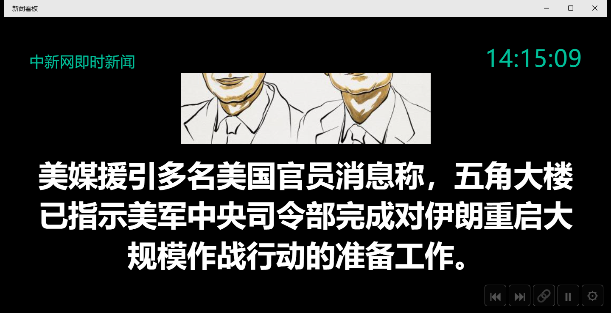
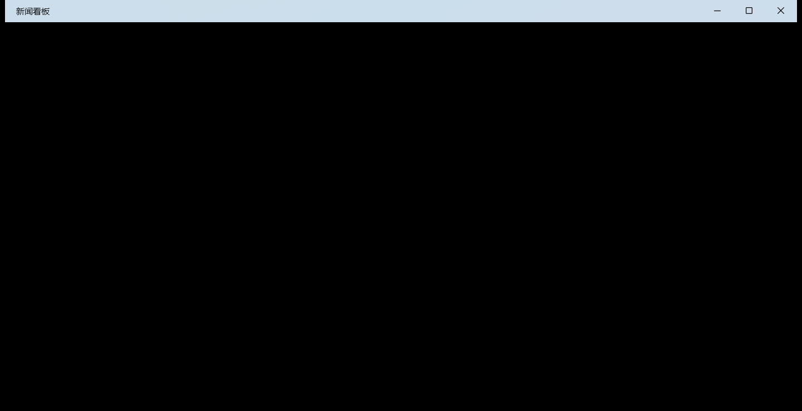
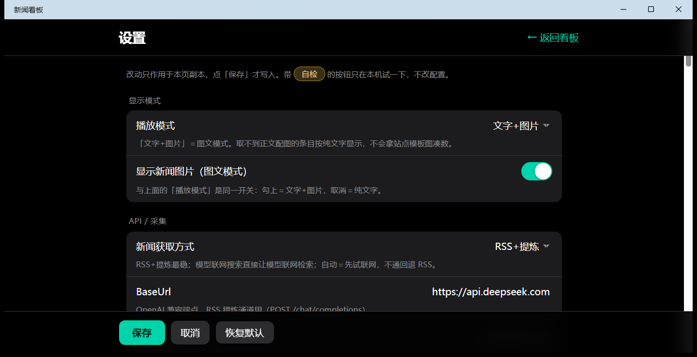

# NewsBoard — panel de noticias en letra grande

[English](README.md) | [中文](README.zh-CN.md) | **Español**

> NewsBoard — un panel de noticias en letra grande: obtiene las noticias del día, deja que un modelo las filtre y las muestra en pantalla en letra grande con lectura en voz alta.

## Qué problema resuelve

Obtiene las noticias del día, deja que un modelo las filtre (resumen + importancia) y las muestra en pantalla en **letra grande con lectura en voz alta**: 60 segundos visible → 300 segundos en apagado → repetir. Está pensado para colgarse en una pared, en un decodificador de TV o en una tableta siempre encendida como panel informativo.

- **Rotación en letra grande** — 1 elemento por pantalla; lo que no cabe en el área visible se desplaza. Por defecto, 60 segundos visible y 300 segundos en apagado.
- **Filtrado por modelo** — cada elemento lleva un resumen de 70 caracteres y una importancia de 0–1; lo que queda por debajo del umbral de importancia (0.7 por defecto) nunca entra en la lista de reproducción.
- **Lectura en voz alta** — el TTS del sistema lee el resumen y el elemento termina cuando termina la lectura: la lectura *es* el reloj de ese elemento.

NewsBoard es un panel de noticias en letra grande **multiplataforma**: **1 conjunto de componentes Razor (`NewsBoard.Shared`, sin dependencias de plataforma) más varios hosts**. **Hoy se admiten Android y Windows**, con 3 hosts ejecutables:

| Plataforma | Host | Pila / TFM | Estado |
|---|---|---|---|
| Android | `NewsBoard.Maui` | .NET MAUI + `BlazorWebView`, `net10.0-android` | Admitido; instalado y medido en un dispositivo real (Android 13 / arm64-v8a), genera el APK |
| Windows | `NewsBoard.Wpf` | WPF + WebView2, `net10.0-windows10.0.19041.0` | Admitido; medido en esta máquina; `dotnet publish -c Release` genera 45 archivos / 28.14MB |
| Windows | Cabecera Windows de `NewsBoard.Maui` | .NET MAUI + `BlazorWebView`, el mismo TFM | Admitido; se ejecuta sin empaquetar con `WindowsPackageType=None`, necesita Windows App Runtime (aquí 1.6 / 1.7 / 1.8) |



*El panel en un teléfono Android: una etiqueta de palabra clave, el reloj, el resumen en letra grande y la barra de control de 5 botones.*

## Inicio rápido

Requisitos: **.NET SDK 10** (medido aquí: 10.0.203 / runtime 10.0.7); en Windows también hace falta el **WebView2 Runtime** (medido aquí: 154.0.4258.62). La primera vez hay que pegar una API Key de DeepSeek en la página de Ajustes; sin ella fallan tanto la obtención como el resumen con modelo.

**Windows**

```powershell
# Host WPF (la forma más rápida de verlo funcionando)
dotnet run --project src\NewsBoard.Wpf

# Cabecera Windows de MAUI
dotnet run --project src\NewsBoard.Maui -f net10.0-windows10.0.19041.0
```

**Android**

```powershell
# Compilar el APK de Android (salida: bin\Debug\net10.0-android\*-Signed.apk)
Set-ExecutionPolicy -Scope Process -ExecutionPolicy Bypass -Force; . .\scripts\android-env.ps1
dotnet build src\NewsBoard.Maui\NewsBoard.Maui.csproj -f net10.0-android -v q --nologo

# Compilar e instalar en un dispositivo conectado (las compilaciones de depuración deben usar este destino)
Set-ExecutionPolicy -Scope Process -ExecutionPolicy Bypass -Force; . .\scripts\android-env.ps1
dotnet build src\NewsBoard.Maui\NewsBoard.Maui.csproj -f net10.0-android -t:Install -v q --nologo
```

**Todas las plataformas**

```powershell
# Solución completa (WPF + MAUI/Android + MAUI/Windows)
Set-ExecutionPolicy -Scope Process -ExecutionPolicy Bypass -Force; . .\scripts\android-env.ps1
dotnet build NewsBoard.slnx -v q --nologo

# Pruebas unitarias
dotnet test src\NewsBoard.Tests\NewsBoard.Tests.csproj --nologo
```

> Las compilaciones de Android **deben** hacer `dot-source` de `scripts\android-env.ps1` primero; si no, aparece `XA5300 Android SDK not found` (la política de ejecución de esta máquina es Restricted, de ahí el permiso temporal solo para este proceso). Los requisitos completos de Android y los detalles de instalación están en [docs/android.es.md](docs/android.es.md).

## Diferencias de capacidades por plataforma

| Capacidad | Android | Windows (`NewsBoard.Wpf`) | Windows (cabecera Windows de `NewsBoard.Maui`) |
|---|---|---|---|
| Apagado / pantalla apagada | Brillo de ventana a 0 + una capa negra; **la retroiluminación física sigue encendida** | **Apaga de verdad el monitor** (`WM_SYSCOMMAND` / `SC_MONITORPOWER`, 2 = apagar / -1 = encender) | Igual que WPF; pero esta cabecera no hace pantalla completa sin bordes, así que la protección se degrada a «solo primer plano» |
| Protección al apagar la pantalla | No aplica | Apaga el monitor solo cuando esta app está en primer plano **o** en pantalla completa sin bordes; **volver a encenderlo no tiene restricción** | Igual que a la izquierda, pero la condición de pantalla completa es siempre falsa |
| Mantener pantalla encendida | Lo asume el indicador de ventana `KEEP_SCREEN_ON`, **no se retira ni durante el apagado** | Implementación vacía (en escritorio no hace falta) | Implementación vacía |
| Pantalla completa | Inmersiva: oculta la barra de estado del sistema (`AndroidShowStatusBar`) | Pantalla completa sin bordes (F11 para entrar / Esc para salir; medido `1600x1000@(160,10)` → `1920x1080@(0,0)`) | No se hace (`SetFullscreenAsync` es una implementación vacía) |
| Síntesis de voz | Motor TTS propio del dispositivo (medido `com.xiaomi.mibrain.speech`) | `System.Speech` (medido `Microsoft Huihui Desktop` zh-CN; `SpeakCompleted` es fiable) | `System.Speech` (igual que WPF) |
| Inicio automático al arrancar | `BootReceiver` + servicio en primer plano + notificación permanente; los gestores de inicio automático del fabricante (p. ej. MIUI) pueden bloquearlo | `HKCU\Software\Microsoft\Windows\CurrentVersion\Run` | Igual que WPF |
| Directorio de configuración / caché | Directorio privado de la app (paquete `com.newsboard.app`) | `%LOCALAPPDATA%\NewsBoard\` (`config.json` / `news.json`) | Igual que WPF, **totalmente compartido con WPF** |
| API Key | MAUI `SecureStorage` (cifrado con Android Keystore, no es un archivo en texto plano) | `%APPDATA%\NewsBoard\secret.dat` (DPAPI CurrentUser + entropy `NewsBoard.SecretStore.v1`) | Igual que WPF (los 2 hosts comparten 1 sola clave) |
| Abrir el artículo original | Navegador del sistema (Intent) | Navegador predeterminado | Navegador predeterminado |
| Sustitución del directorio de datos | Variable de entorno `NEWSBOARD_DATA_DIR` (común a los 3 hosts) | Igual que a la izquierda | Igual que a la izquierda |

## Cómo se ve

Página del panel (`Display.razor`): **1** etiqueta de palabra clave arriba, un reloj y el resumen en letra grande (con imagen en el modo texto + imagen); abajo a la derecha hay 5 botones de icono en fila — **anterior / siguiente / abrir original / interrumpir esta ronda / ajustes**.

- **Toca la pantalla durante el apagado para volver** (`PlaybackEngine.WakeAsync()`: sale del apagado de inmediato y reinicia la ventana desde el elemento actual). Durante el apagado la barra de control está oculta, así que el toque siempre cae en la capa negra; un toque táctil funciona igual.
- **Interrumpir**: entra en el apagado de inmediato y espera «duración del apagado» segundos, luego continúa con la siguiente ronda; el apagado sigue ocurriendo aunque el ciclo esté desactivado.
- Anterior / siguiente dan la vuelta a la lista; «abrir original» abre el enlace de la noticia actual en el navegador del sistema.

| Modo texto + imagen | Apagado | Página de Ajustes |
|---|---|---|
|  |  |  |

La página de Ajustes (`Settings.razor`) usa una lista agrupada al estilo iOS, en este orden:

| Grupo | Contenido |
|---|---|
| **Modo de visualización** | Modo de reproducción (solo texto / texto + imagen) más el interruptor derivado «mostrar imágenes de las noticias» (misma fuente, enlazados) |
| **API / obtención** | Modo de obtención, BaseUrl / Model / endpoint de búsqueda web y max_uses, API Key, lista de palabras clave, elementos por palabra clave, intervalo de obtención, longitud del resumen, **idioma del resumen**, intervalo mínimo entre llamadas a la IA, fuente RSS y alternativas, solo noticias de hoy, **umbral de importancia**, **días de retención** |
| **Apariencia** | Colores de fondo / primer plano / acento, tamaño y grosor del texto, altura de línea, margen interior, tamaño de la etiqueta de palabra clave, alineación, mostrar reloj, **tamaño / tipografía del reloj**, mostrar palabra clave / título / fuente |
| **Reproducción / voz** | Interruptor de lectura, qué leer, idioma, velocidad, tono, silencio inicial, horas de silencio, política cuando el TTS no está disponible, duración visible, permanencia por elemento, velocidad de desplazamiento, duración del apagado, ciclo de apagado, modo de apagado, comportamiento al terminar la ventana, posición y porcentaje de pantalla de la imagen, orden de reproducción, reanudar entre rondas |
| **Sistema / host** | Mantener pantalla encendida, inicio automático al arrancar, obtener solo por Wi-Fi, pantalla completa sin bordes en Windows, barra de estado de Android |

Abajo hay 3 botones fijos: **guardar / cancelar / restaurar valores predeterminados**; «cancelar» es un enlace de vuelta al panel que descarta los cambios no guardados.

> Los id de los controles se corresponden casi directamente con los campos de configuración (camelCase): por ejemplo `playbackMode` / `showImages` / `summaryLanguage` / `summaryMaxChars` / `importanceThreshold` / `retentionDays` / `clockFontSize` / `clockFontFamily` / `speechEnabled` / `showDuration` / `blackoutDuration` / `winFullscreen`. La lista completa está en `plans/news-board.plan.md` y `Settings.razor`.

## Dónde viven tus datos

| Versión | Archivo de configuración | Caché de noticias | API Key |
|---|---|---|---|
| WPF | `%LOCALAPPDATA%\NewsBoard\config.json` | `%LOCALAPPDATA%\NewsBoard\news.json` | `%APPDATA%\NewsBoard\secret.dat` (cifrado con DPAPI CurrentUser, **nunca en texto plano**) |
| MAUI (Windows) | igual que arriba (**compartido con WPF**) | igual que arriba | igual que arriba (los 2 hosts comparten 1 sola clave) |
| MAUI (Android) | directorio privado de la app (`LocalApplicationData`, paquete `com.newsboard.app`) | igual que a la izquierda | MAUI `SecureStorage` (cifrado con Android Keystore, no es un archivo en texto plano) |

- **Cambiar el directorio de datos**: define la variable de entorno `NEWSBOARD_DATA_DIR` (cualquier valor no vacío manda; `ConfigStore` y `NewsRepository` comparten este único punto de resolución). Los scripts de automatización y de sondeo **deben** apuntarla a un directorio aislado en lugar del real.
- **Revertir una escritura accidental**: antes de cada sobrescritura, `ConfigStore` guarda la versión anterior como `config.json.bak`.
- **Cómo llega la Key a Android**: el `secret.dat` de Windows está cifrado con DPAPI (usuario actual) y **atado a esa máquina**, así que copiarlo al teléfono no sirve. En un dispositivo nuevo hay que volver a pegar la API Key de DeepSeek dentro de la app, en Ajustes → API / obtención (va al `SecureStorage` cifrado con Android Keystore, también sin texto plano).
- **Inicio automático al arrancar** (Windows) se escribe en `HKCU\Software\Microsoft\Windows\CurrentVersion\Run`.
- `ApiKey` **nunca se escribe en el JSON** (el campo lleva `[JsonIgnore]` y se inyecta desde el almacén seguro de la plataforma).

## Cómo llegan las noticias

```
Temporizador (5 minutos por defecto) / arranque
  → canal: fuente RSS de canal (respaldo) o búsqueda web del modelo («auto» por defecto = primero búsqueda web, si falla vuelve a RSS)
  → deduplicación por URL (lo ya resumido nunca vuelve a llamar a la IA)
  → los elementos con descripción corta obtienen el cuerpo del artículo (máximo 5 por ronda)
  → resumen con modelo: resumen (70 caracteres por defecto) + importancia 0–1 + palabra clave de clasificación
  → modo texto + imagen: búsqueda de imagen en 4 niveles (og:image → twitter:image → image_src → primera imagen del cuerpo del artículo) + 1 imagen pertenece a exactamente 1 elemento
  → caché (se conserva 3 días naturales; lo caducado se purga junto con sus registros de deduplicación)
  → lista de reproducción: filtrar por umbral de importancia (0.7 por defecto) → reproducir en el orden configurado (aleatorio por defecto)
```

- Cuando el umbral deja la caché vacía, el panel **elige 1 elemento al azar** y le añade ` ~` al final del resumen, señalando que en realidad no alcanzaba el umbral.
- Quedarse en «obteniendo noticias…» normalmente significa: todavía no hay API Key, el sitio de origen no está disponible en ese momento, o el umbral está demasiado alto.
- El idioma del resumen es chino simplificado por defecto; tras cambiarlo, **los resúmenes ya guardados en caché no se reescriben** (borra `news.json` o espera a que caduque el día natural para volver a obtenerlos).

Las reglas completas (deduplicación y enfriamiento de la IA, obtención del cuerpo, validación de la longitud del resumen, exclusividad de imagen, agrupación por día natural) están en [docs/news-pipeline.es.md](docs/news-pipeline.es.md).

## Documentación

| Documento | Qué cubre |
|---|---|
| [docs/index.es.md](docs/index.es.md) | Índice de la documentación: 8 documentos temáticos y por dónde empezar |
| [docs/architecture.es.md](docs/architecture.es.md) | Los 3 proyectos y la dirección de dependencias, árbol de directorios, flujo de datos desde el arranque hasta la reproducción, contrato congelado |
| [docs/configuration.es.md](docs/configuration.es.md) | Ubicación de los archivos de configuración, dónde vive la Key, los 5 grupos de Ajustes, tabla completa de campos |
| [docs/news-pipeline.es.md](docs/news-pipeline.es.md) | Los 2 canales y el orden de respaldo, deduplicación y enfriamiento de la IA, obtención del cuerpo, resúmenes e importancia, imágenes |
| [docs/playback.es.md](docs/playback.es.md) | Máquina de estados de reproducción, la lectura como reloj del elemento, los 5 botones y gestos, diferencias de apagado por plataforma, resultados de la prueba de larga duración |
| [docs/android.es.md](docs/android.es.md) | Cadena de herramientas de Android, comandos de compilación e instalación, aceptación en dispositivo real, 3 hechos de la plataforma |
| [docs/windows.es.md](docs/windows.es.md) | Hosts de Windows: el host WPF y la cabecera Windows de MAUI |
| [docs/troubleshooting.es.md](docs/troubleshooting.es.md) | Síntoma → causa → solución, cada uno con un comando ejecutable |
| [docs/contributing.es.md](docs/contributing.es.md) | Entorno y comandos, propiedad de archivos, convenciones de código, puerta previa al commit, disciplina de documentación |
| [docs/android-env-report.md](docs/android-env-report.md) | Informe medido del entorno de la cadena de herramientas de Android (un solo idioma) |

## Desarrollo

```powershell
dotnet build src\NewsBoard.Shared\NewsBoard.Shared.csproj -v q --nologo
dotnet test  src\NewsBoard.Tests\NewsBoard.Tests.csproj --nologo
dotnet build NewsBoard.slnx -v q --nologo          # las 3 cabeceras (antes, dot-source de android-env.ps1)
```

Las convenciones, el contrato congelado y todos los hechos medidos (incluidas las trampas que encontramos) están en `AGENTS.md`; [docs/contributing.es.md](docs/contributing.es.md) describe el flujo de colaboración. Las compilaciones deben pasar antes de hacer commit, y las ramas con lógica necesitan pruebas xunit.

## Verificación medida

| Punto | Resultado |
|---|---|
| Pruebas unitarias | `dotnet test` **224/224** correctas (13 segundos) |
| Android en dispositivo real | Xiaomi `M2011K2C` (Redmi K40) / Android 13 / arm64-v8a: 6 palabras clave obtuvieron **16 elementos**; al pulsar «interrumpir» el brillo de la ventana pasó de `NaN` a `0.0` en 1.2 segundos y la captura pasó de 300 KB a 27 KB; el TTS leyó **7.4–14.6 segundos** por elemento, con unos 1 segundo entre elementos; una prueba de 20 minutos no mostró FATAL/ANR, con la memoria subiendo de 230 MB a 295–302 MB y luego estabilizándose; el arranque en frío renderizó el panel en +5.2 segundos |
| Los 2 hosts de Windows | WPF: por defecto `1600x1000@(160,10)` con barra de título → F11 `1920x1080@(0,0)` a pantalla completa → Esc restaura; cabecera Windows de MAUI: proceso vivo, 12 procesos hijos `msedgewebview2`, noticias reales renderizadas; modo texto + imagen con `ImageScreenPercent=40` verificado como imagen arriba y texto abajo |
| Disponibilidad de fuentes RSS | chinanews `scroll-news` / `china` / `world`, people.com.cn `politics` / `world` e ithome funcionan; Bing `?format=RSS` devuelve HTML, Baidu `newsrss` devuelve una página de verificación de seguridad y Google News RSS agota el tiempo de espera (medido el 2026-10-08) |

## Limitaciones conocidas

**Android**

- **Android está instalado y revisado punto por punto** (2026-10-08, Xiaomi `M2011K2C` / Redmi K40 / Android 13 / arm64-v8a): renderizado de arranque, 6 palabras clave que obtuvieron 16 elementos, etiqueta de palabra clave + reloj + resumen en letra grande + barra de control, configuración y caché en el directorio privado de la app; al pulsar «interrumpir» el brillo de la ventana llega a 0 y la pantalla se pone negra en 1.2 segundos, y al tocar la pantalla se restaura; `KEEP_SCREEN_ON` mantiene la pantalla encendida; el TTS chino realmente lee elemento a elemento (5 AudioTrack `CONTENT_TYPE_SPEECH` consecutivos en `dumpsys audio`, de 7.4–14.6 segundos cada uno, con unos 1 segundo entre elementos).
- **El «apagado» de Android no es apagar la pantalla físicamente**: solo pone el **brillo de la ventana a 0 y pinta la pantalla de negro**; la retroiluminación sigue encendida. Una app normal de Android no tiene forma de apagar el panel sin permisos (`GoToSleep()` es un permiso de firma; `LockNow()` necesita administrador del dispositivo, bloquea la pantalla y luego exige desbloquear para despertar). Solo la versión de Windows apaga de verdad el monitor (`SC_MONITORPOWER`).
- **El inicio automático al arrancar en Android necesita aprobación del fabricante**: la ruta del código es correcta (`BootReceiver` sí recibe `BOOT_COMPLETED`), pero en este dispositivo el gestor de inicio automático de MIUI lo bloquea (registro del sistema `process is not permitted to auto start`, `MIUIOP(10021): ignore`). **Para permitirlo a mano**: Ajustes → Aplicaciones → Gestionar aplicaciones → NewsBoard → **Inicio automático** (activado); conviene poner también la política de ahorro de batería en **sin restricciones**. Después de eso, al reiniciar aparece la notificación permanente (no usa `StartActivity`; toca la notificación para abrir el panel).
- **La calidad del TTS en Android depende del motor de voz del propio teléfono** (aquí `com.xiaomi.mibrain.speech`); el timbre y la naturalidad los juzgas tú: la app solo le entrega el resumen.

**Windows**

- **El apagado real de pantalla en Windows no está confirmado a mano**: la implementación usa `SC_MONITORPOWER` con una protección (solo apaga el monitor cuando esta app está en primer plano o en pantalla completa sin bordes, mientras que volver a encenderlo no tiene restricción), pero la automatización nunca provocó un cambio real de retroiluminación.

**Independiente de la plataforma**

- **El canal de búsqueda web no devuelve el cuerpo del artículo, pero el cuerpo se obtiene igual**: ese canal toma el resumen directamente del modelo, pero la obtención del cuerpo se aplica por igual a los 2 canales (se dispara cuando `Description` tiene menos de 300 caracteres), así que `RawContent` puede ser no nulo en elementos del canal de búsqueda web. Medido en la caché de esta máquina: **313 elementos** (todos de búsqueda web), **92** de ellos con `RawContent` no nulo, de 109–2000 caracteres; los que fallaron siguen siendo null.
- **Cambiar el idioma del resumen no reescribe los resúmenes en caché** (ver «Cómo llegan las noticias» arriba).
- El interruptor de filtro **«mostrar solo las noticias que coinciden con una palabra clave»** **no está implementado**; ahora mismo las palabras clave solo se usan como etiquetas de agrupación y para mostrar.

## Licencia

[MIT](LICENSE)
