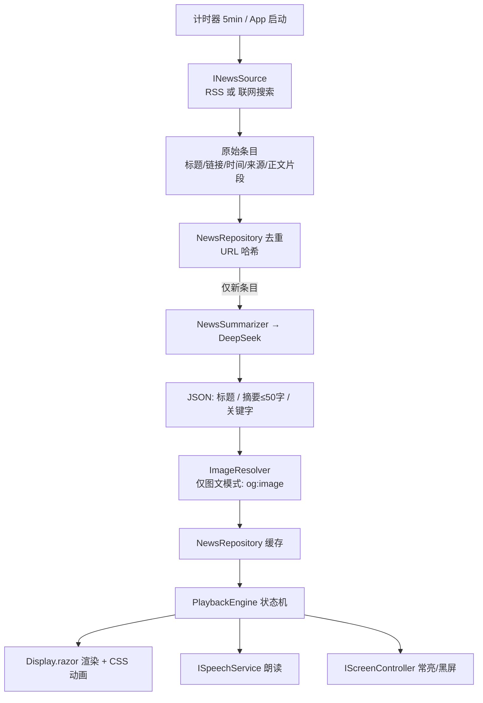
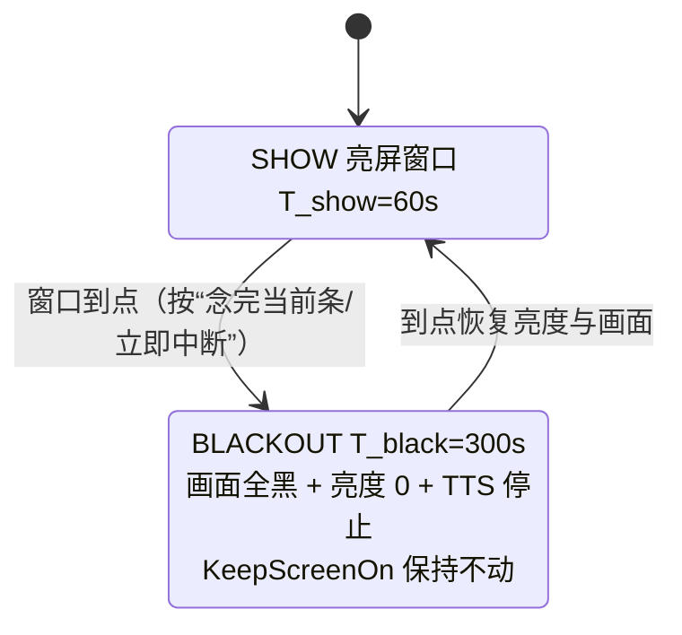

# MauiNewsBoard — 安卓大字新闻看板 · 实施方案

> 类型：实施计划（plan）。状态：**第 2 稿（已处理画布批注 fb-5 ~ fb-8），等待 Approve**。
> 技术栈：Blazor（RCL）+ .NET MAUI Blazor Hybrid（Android）+ WPF + WebView2（Windows），三个 csproj。

---

## 0. 为什么是这套技术（结论回顾）

| 需求 | 快应用 | MAUI Blazor Hybrid / WPF + BlazorWebView |
|---|---|---|
| 大字轮播 + 抓新闻 | ✅ | ✅ |
| 不锁屏 / 不熄屏 | 靠 `setKeepScreenOn`，后台禁用 | ✅ `DeviceDisplay.Current.KeepScreenOn = true`（Android） |
| “熄屏”5 分钟 | ❌ 无任何关屏能力 | ✅ 窗口亮度置 0 + 画面全黑（免权限） |
| 5 分钟后自己亮回来 | ❌ JS 被冻结，无唤醒机制 | ✅ 从未真关屏，进程一直前台，计时器可靠 |
| 语音播报 | ❌ 无 TTS 接口 | ✅ Android 原生 TTS / Windows `System.Speech` |
| 安装分发 | ❌ 必须上架 | ✅ APK 随便装；Windows 直接跑 exe |

---

## 1. 范围

### 做
- **Android**：常驻看板，大字新闻轮播；亮 60s → 全黑 300s → 循环，全程不锁屏。默认显示系统状态栏，设置里可切沉浸式全屏（fb-10）。
- **Windows**：同一套 Razor 组件，由 **WPF + WebView2** 承载；默认普通带标题栏窗口，设置里可切无边框全屏（fb-10）。不做常亮/黑屏那套，桌面无此需求。
- 定时（默认 5 分钟）获取新闻 → LLM 提炼成 50 字左右摘要 → 轮播。
- **语音播报**：系统 TTS 把当前新闻概要念一遍（可关闭）；朗读结束即该条播放结束，切下一条。
- 全部外观/行为参数可在 App 内配置并持久化。
- 两种播放模式：纯文字、文字+图片。

### 不做
- 不做账号体系、云端同步、多设备管理。
- 不接任何商业新闻聚合 API（天行/NewsAPI 之类）。
- 不做 iOS。

---

## 2. 决策记录

### D1｜新闻内容从哪来 —— **双通道，可配置**

| 通道 | 做法 | 说明 |
|---|---|---|
| **A. 模型联网搜索** | 走 DeepSeek 的 **Anthropic 兼容端点** `POST {BaseUrlSearch}/anthropic/v1/messages`，带服务端搜索工具 `{"type":"web_search_20250305","name":"web_search","max_uses":N}`。模型自己联网检索 → 直接返回已总结的 JSON | DSH 本机内置 web_search 走的就是 `https://api.deepseek.com/anthropic/v1/messages`，该通道在你的 Key 上大概率可用（**T0 先实测**） |
| **B. RSS 取原文 + 提炼** | App 抓 RSS（`https://www.bing.com/news/search?q={关键字}&format=RSS`）拿真实原文 → 交给 DeepSeek（标准 `/chat/completions`）提炼 | 保底，永远可用。RSS 是新闻站自己的公开 feed，不是第三方新闻 API 服务商 |

配置项 `新闻获取方式` 三选：`RSS+提炼`（默认）/ `模型联网搜索` / `自动`（先试联网，不可用回退 RSS）。架构上抽成 `INewsSource`，换通道不动业务代码。

### D2｜图片来源 —— **源站 og:image，取不到就纯文字**

从源站文章页抓 `og:image`。失败/超时 3s → 退化为纯文字卡片，不留破图。

### D3｜亮熄节奏 —— **亮 60s（窗口内播若干条）→ 黑 300s → 循环**

60 秒是一个展示窗口，窗口内按顺序过新闻条目。到点切黑屏 300 秒，然后循环。

### D4｜项目拆分 —— **三个 csproj**（画布批注 fb-5）

| 项目 | TFM | 职责 |
|---|---|---|
| `NewsBoard.Shared` | `net10.0` | Razor 类库（RCL）：**全部** UI 组件、wwwroot（css/js）、配置模型、抓取、提炼、播放引擎、平台抽象接口。**零平台依赖** |
| `NewsBoard.Maui` | `net10.0-android`；`net10.0-windows10.0.19041.0` | Android 宿主（MAUI Blazor Hybrid）。Windows TFM 保留用于 PC 上快速调试 Blazor 层。提供 Android 平台实现（屏幕控制、TTS） |
| `NewsBoard.Wpf` | `net10.0-windows` | Windows 桌面宿主：WPF + `Microsoft.AspNetCore.Components.WebView.Wpf`（基于 WebView2）承载同一套 Razor 组件。提供 Windows 平台实现（TTS） |

依赖方向单一：`Maui → Shared`、`Wpf → Shared`；**Shared 永远不反向依赖宿主**。

### D5｜语音播报 —— **系统 TTS，可关，朗读即播放时长**（画布批注 fb-6）

- 朗读内容：当前新闻概要（可选连标题一起念）。
- **朗读结束 = 该条播放结束 → 切下一条**（TTS 成为该条的播放时钟）。
- 与溢出滚动联动：滚动速度按剩余朗读时长动态调整，**念完那一刻基本滚到底**；朗读结束时若还没滚到底，0.5s 内加速收尾。
- TTS 关闭或不可用时，回退到固定停留时长 `T_hold`（默认 12s）/ 滚动到底。
- 黑屏期间停止播报。

---

## 3. 架构

### 3.1 项目结构

```
maui-news-board/
├── NewsBoard.sln
├── .claude/plans/news-board.plan.md          ← 本文件
└── src/
    ├── NewsBoard.Shared/                     ← ① Razor 类库（net10.0，零平台依赖）
    │   ├── NewsBoard.Shared.csproj           （RCL：Microsoft.AspNetCore.Components.Web）
    │   ├── _Imports.razor
    │   ├── Components/
    │   │   ├── Routes.razor
    │   │   ├── Pages/Display.razor           （播放页：唯一常驻页面）
    │   │   ├── Pages/Settings.razor          （配置页）
    │   │   └── Shared/NewsCard.razor         （单条渲染：纯文字 / 图文）
    │   ├── Services/
    │   │   ├── AppConfig.cs                  （全部配置模型）
    │   │   ├── ConfigStore.cs                （JSON 持久化 + Key 存平台安全存储）
    │   │   ├── INewsSource.cs
    │   │   ├── RssNewsSource.cs              （D1-B）
    │   │   ├── WebSearchNewsSource.cs        （D1-A）
    │   │   ├── NewsSummarizer.cs             （DeepSeek 提炼 + JSON 解析 + 重试）
    │   │   ├── NewsRepository.cs             （缓存 + URL 去重）
    │   │   ├── PlaybackEngine.cs             （播放状态机）
    │   │   └── Abstractions/
    │   │       ├── IScreenController.cs      （常亮 / 黑屏 / 亮度）
    │   │       ├── ISpeechService.cs         （TTS：朗读 + 完成回调）
    │   │       └── ISecretStore.cs           （API Key 安全存储）
    │   └── wwwroot/
    │       ├── css/app.css                   （大字排版、滚动动画、过渡）
    │       └── js/measure.js                 （溢出测量 + 滚动进度回调）
    ├── NewsBoard.Maui/                       ← ② Android 宿主
    │   ├── NewsBoard.Maui.csproj             （net10.0-android; net10.0-windows10.0.19041.0）
    │   ├── MauiProgram.cs                    （DI：注册平台实现）
    │   ├── App.xaml(.cs) / MainPage.xaml(.cs)（BlazorWebView 宿主；默认显示系统状态栏，可配沉浸式全屏）
    │   ├── Platforms/Android/
    │   │   ├── AndroidManifest.xml           （INTERNET、WAKE_LOCK、POST_NOTIFICATIONS）
    │   │   └── MainActivity.cs
    │   └── Services/
    │       ├── AndroidScreenController.cs    （KeepScreenOn + 窗口亮度 0 + 恢复）
    │       ├── AndroidSpeechService.cs       （原生 Android.Speech.Tts + UtteranceProgressListener）
    │       └── MauiSecretStore.cs            （SecureStorage）
    └── NewsBoard.Wpf/                        ← ③ Windows 宿主
        ├── NewsBoard.Wpf.csproj              （net10.0-windows，WPF，WebView2）
        ├── App.xaml(.cs)
        ├── MainWindow.xaml(.cs)              （BlazorWebView 控件，全屏/无边框可配）
        └── Services/
            ├── WpfScreenController.cs        （桌面：空实现 / 可选全屏黑）
            ├── WpfSpeechService.cs           （System.Speech.Synthesis.SpeechSynthesizer）
            └── WpfSecretStore.cs             （DPAPI ProtectedData）
```

### 3.2 数据流



> 走「模型联网搜索」通道时，`INewsSource` 直接返回摘要，按 `IsPreSummarized` 标记跳过 `NewsSummarizer`。

### 3.3 分层原则

- **平台能力全在宿主项目**：屏幕控制、TTS、密钥存储 —— 通过 Shared 定义的接口注入，Shared 不出现 `#if ANDROID`。
- **Shared 只有纯 .NET 逻辑**：抓取、提炼、去重、缓存、播放状态机、全部 Razor 组件 —— 这样三端共用一份，且能在 PC 上用 WPF 宿主快速调试。
- **Blazor 只管渲染**：接收 `NewsItem` + `DisplayOptions`，输出 HTML/CSS。

### 3.4 开机自启实现（fb-9 定为 `true`）

| 平台 | 做法 | 坑 |
|---|---|---|
| Android | `RECEIVE_BOOT_COMPLETED` 权限 + `BootReceiver` 监听 `BOOT_COMPLETED`，拉起前台服务并在通知栏放一个「点击进入看板」的常驻通知 | Android 10+ **禁止后台启动 Activity**，广播里直接 `StartActivity` 会被系统拦掉。常驻类应用的标准解法是「前台服务 + 全屏通知」，并引导用户把 App 加进厂商自启动白名单（小米 / 华为 / OPPO / vivo 各有一套） |
| WPF | 写 `HKCU\Software\Microsoft\Windows\CurrentVersion\Run` 一个值，或往「启动」文件夹放快捷方式 | 无 |

首次进入设置页时提供「一键申请自启动权限」引导（跳到系统对应设置页）。

---

## 4. 配置项清单（App 内设置页，JSON 持久化）

### 4.1 API / 采集

| 配置项 | 类型 | 默认值 | 说明 |
|---|---|---|---|
| 新闻获取方式 | enum | `RSS+提炼` | `RSS+提炼` / `模型联网搜索` / `自动` |
| BaseUrl | string | `https://api.deepseek.com` | OpenAI 兼容端点（RSS 提炼通道） |
| Model | string | `deepseek-flash` | 模型名可填（官方名是 `deepseek-chat`） |
| BaseUrlSearch | string | `https://api.deepseek.com/anthropic` | 联网搜索端点（Anthropic 兼容） |
| 联网搜索 max_uses | int | `3` | 每关键字允许模型调用搜索工具次数 |
| ApiKey | string | 空 | 存平台安全存储，**不落 JSON 明文** |
| 关键字列表 | string[] | `武汉, 中国, 美国, 台湾, 国际, AI` | 可增删排序 |
| 每关键字篇数 X | int | `3` | 每关键字各取 X 篇 |
| 抓取间隔 | int(分钟) | `5` | 定时抓取周期 |
| 摘要字数 | int | `50` | ±10 字软约束 |
| AI 最小调用间隔 | int(分钟) | `10` | 防止源站抖动重复烧 token |
| RSS 源模板 | string | Bing News RSS | `https://www.bing.com/news/search?q={q}&format=RSS` |
| 只用当天新闻 | bool | `true` | 过滤超过 24h 的旧闻 |

### 4.2 外观

| 配置项 | 类型 | 默认值 |
|---|---|---|
| 背景色 | color | `#000000` |
| 前景色（正文） | color | `#FFFFFF` |
| 强调色（关键字标签/时钟） | color | `#00D4AA` |
| 字号（正文） | int(sp) | `56` |
| 字重 | enum | Bold |
| 行距倍数 | double | `1.35` |
| 页面内边距 | int(px) | `48` |
| 关键字标签字号 | int(sp) | `28` |
| 文字对齐 | enum | 居中 |
| 显示时钟 | bool | `true` |
| 显示关键字标签 | bool | `true` |
| 显示新闻来源 | bool | `false` |

### 4.3 播放 / 语音

| 配置项 | 类型 | 默认值 | 说明 |
|---|---|---|---|
| 播放模式 | enum | 纯文字 | 纯文字 / 文字+图片 |
| **启用语音播报** | bool | `true` | 关掉则回退固定停留时长 |
| 播报内容 | enum | 仅摘要 | 仅摘要 / 标题+摘要 |
| 语速 | double | `1.0` | 0.5–2.0 |
| 音调 | double | `1.0` | 0.5–2.0 |
| 播报语言 | string | `zh-CN` | 走系统 TTS 语音包 |
| 播报前静默 | int(秒) | `1` | 切条后先静默再开口 |
| 静音时段 | string | 空 | 形如 `23:00-07:00`，该时段内只显示不朗读；留空 = 全天可播 |
| TTS 不可用时 | enum | 回退固定停留 | 回退固定停留 / 跳过该条 |
| 亮屏时长 | int(秒) | `60` | 一轮展示窗口 |
| 单条基础停留 | int(秒) | `12` | 仅 TTS 关闭时生效 |
| 溢出滚动速度 | int(px/秒) | `60` | 仅 TTS 关闭时生效；TTS 开启则按朗读时长动态调速 |
| 黑屏时长 | int(秒) | `300` | 全黑 + 亮度 0 |
| 启用亮熄循环 | bool | `true` | 关掉则一直亮屏 |
| 黑屏方式 | enum | `亮度0+全黑` | 也可只全黑保留背光 |
| 窗口到点行为 | enum | 念完当前条 | 念完当前条 / 立即中断 |
| 图文模式图片位置 | enum | 上图下文 | 上图下文 / 左图右文 |
| 图片占屏比例 | int(%) | `40` | |
| 轮播顺序 | enum | 按关键字顺序 | 按关键字顺序 / 按发布时间 / 随机 |
| 跨轮续播 | bool | `true` | 单条未播完是否下一轮接着播 |

### 4.4 系统 / 宿主

| 配置项 | 类型 | 默认值 | 备注 |
|---|---|---|---|
| 保持屏幕常亮 | bool | `true` | Android 生效（fb-7） |
| 开机自启 | bool | `true` | **fb-9 定稿**；实现见 §3.4 |
| 仅 WiFi 抓取 | bool | `false` | **fb-9 定稿**：允许移动数据抓取 |
| Windows 无边框全屏 | bool | `false` | **fb-10 定稿**：默认带标题栏窗口，设置里可开无边框全屏 |
| Android 显示系统状态栏 | bool | `true` | **fb-10 定稿**：默认显示状态栏（时钟/电量），设置里可关（沉浸式全屏） |

---

## 5. 播放引擎（核心逻辑）

### 5.1 状态机



- 黑屏期间**不切换 `KeepScreenOn`** —— 屏幕物理上一直亮着，所以系统不会锁屏；“熄屏”只是看起来黑。
- 未播完的条目按 `跨轮续播` 决定续播或丢弃。

### 5.2 单条新闻的播放生命周期（TTS 开启时）

```
切到该条
  → 渲染(按配置字号/边距/配色)
  → 测溢出(js/measure.js: scrollHeight vs clientHeight)
  → 静默 T_lead(默认 1s)
  → 启动 TTS 朗读 + 同时启动滚动
       · 不溢出：静止显示
       · 溢出：滚动速度 = 剩余溢出高度 / 估算剩余朗读时长（随朗读进度动态调速）
  → TTS 完成回调触发（= 该条结束）
       · 若还没滚到底 → 0.5s 加速滚完 → 切下一条
       · 已滚到底 → 直接切下一条
```

- 朗读时长估算：`估算秒数 = 字数 × 每字秒数(语速)`，每字秒数默认按中文 ~0.22s/字 @1.0 语速标定，实测后写死常数。
- TTS 关闭/不可用时：溢出 → 匀速滚到底 + 停 1.5s；不溢出 → 停 `T_hold`。
- 静音时段：只跳过朗读，其余逻辑退化为“TTS 关闭”路径。

### 5.3 “一屏显示全一条，超出则滚动完再跳下一条”

1. 固定高度容器（屏幕高 − 上下内边距）。
2. `scrollHeight > clientHeight` 判定溢出，留 5% 余量避免临界抖动。
3. AI 已把摘要压到 ~50 字，配 56sp 字号正常情况下**不溢出**；滚动是长摘要/大字号组合的兜底。
4. 边界：单条时长 > `T_show` 时按 `跨轮续播` 处理，避免永远播不完第一条。

### 5.4 两种播放模式

- **纯文字**：关键字标签 + 大字摘要 +（可选）时钟。
- **文字+图片**：`og:image` 成功 → 按 `图片位置` + `图片占屏比例` 布局；失败 → 退化为纯文字。

---

## 6. 采集与 AI 提炼

### 6.1 通道 B：RSS 取原文（默认）

- 6 个关键字各发一个 RSS 请求（并发限 3）。
- 解析标题、链接、发布时间、来源站点（`XDocument` 或 `System.ServiceModel.Syndication`）。
- 按 `只用当天新闻` 过滤，每关键字取最新 X 篇。
- 正文片段：优先 RSS `description`；不足时抓源站前 2KB 正文。

### 6.2 通道 A：模型联网搜索

- 每关键字一次请求：`POST {BaseUrlSearch}/v1/messages`，`tools:[{type:"web_search_20250305", name:"web_search", max_uses:N}]`，模型同 `Model`。
- Prompt：针对该关键字联网检索当天新闻，挑最新 X 篇，**只依据检索结果**输出严格 JSON `[{"title","summary","url","keyword"}]`，每条 ≤ 50 汉字。
- 从返回文本提取 JSON（容忍 ```json 围栏）。
- T0 实测该端点；不通则整体走通道 B。

### 6.3 提炼（`NewsSummarizer`，通道 B 用）

- `OpenAI` NuGet 包，`Endpoint = BaseUrl`，标准 `/chat/completions`（DeepSeek 完全兼容）。
- **批量**：同一关键字的 X 篇原文一次请求。
- Prompt 硬约束：只依据原文、**严禁编造**数字/时间/人名；每条 ≤ 50 汉字，讲清「谁 + 做了什么 + 结果/影响」；输出严格 JSON 数组；信息不足则 `summary` 置空（客户端跳过）。
- 失败：超时 15s → 重试 1 次 → 仍失败则退化为「原标题截断到 50 字」。
- 本地二次校验：> 70 字截断到最后一个句号。

### 6.4 去重与成本控制

- **按文章 URL 哈希去重**，已提炼过的永不再调 AI。
- 抓取（5 分钟）与提炼（仅新条目）解耦。
- `AI 最小调用间隔` 兜底。
- 量级：稳定后一小时新文章通常 10–40 条，成本极低。

### 6.5 缓存与降级

- 缓存最近 3 天条目（SQLite 或 `news.json` 于平台 AppData）。
- 断网 → 播缓存 + 离线小点。
- AI 全失败 → 播缓存旧条目；缓存也空 → 显示「正在获取新闻…」。

---

## 7. 环境准备

当前机器实测：`.NET SDK 10.0.300 / 9.0.308` 已装，**未安装任何 workload，`ANDROID_HOME` / `JAVA_HOME` 均为空**。

### Android（大头，15–25GB）
1. `dotnet workload install maui-android`（需管理员权限）
2. Android SDK + platform-tools + JDK 17：
   `dotnet build -t:InstallAndroidDependencies -f net10.0-android -p:AndroidSdkDirectory=<路径> -p:AcceptAndroidSDKLicenses=true`
3. 真机调试：手机开 USB 调试、与 PC 同网段，`dotnet build -t:Run -f net10.0-android`
4. Release 打包体积优化：
   ```xml
   <PublishTrimmed>true</PublishTrimmed>
   <TrimMode>full</TrimMode>
   <AndroidLinkTool>r8</AndroidLinkTool>
   <AndroidLinkResources>true</AndroidLinkResources>
   <RunAOTCompilation>true</RunAOTCompilation>
   <AndroidEnableProfiledAot>true</AndroidEnableProfiledAot>
   <AndroidStripILAfterAOT>true</AndroidStripILAfterAOT>
   ```
   目标：安装后 18–25MB。

### Windows（几乎零成本）
- `NewsBoard.Wpf` 只需 SDK 自带的 WindowsDesktop 目标包 + **WebView2 Runtime**（Win11 自带，Win10 需装 Evergreen Runtime）。
- `dotnet run --project src/NewsBoard.Wpf` 即可起桌面版 —— 也是调试 Blazor 层最快的方式。
- TTS 依赖系统中文语音包（Windows 10/11 通常自带 Microsoft Huihui / Yaoyao 等）。

### 装机后手动设置
- Android：系统设置 → 电池 → 本应用 → **不受限制**。
- Android：确认系统 TTS 引擎与中文语音包可用（设置 → 无障碍 → 文字转语音）。

---

## 8. 任务拆解（每步带自证方式）

| # | 任务 | 验证方式 |
|---|---|---|
| T0 | **实测联网搜索端点** | curl `{BaseUrlSearch}/v1/messages` + `web_search` 工具，确认返回真实搜索结果；不通则永久走通道 B |
| T1 | **三项目骨架 + 环境就绪** | `NewsBoard.sln` 三项目编译通过；WPF 版 `dotnet run` 起窗口显示 Razor 页；MAUI 版出 APK 装进手机能启动 |
| T2 | Shared 空壳：BlazorWebView 宿主（两端） | Android 默认是带系统状态栏的纯色页，设置里开沉浸全屏后状态栏消失；WPF 默认是带标题栏的窗口，开无边框全屏后铺满屏幕、可退出 |
| T3 | `IScreenController`（Android 实现）：常亮 + 亮度 0 + 恢复 | 手动触发黑屏，静置 6 分钟：屏幕不锁、不自动息屏；WPF 用空实现不报错 |
| T4 | `AppConfig` + 设置页 + 持久化 + `ISecretStore` | 改配置 → 杀进程重启配置还在；Key 两端都不落 JSON 明文 |
| T4b | 开机自启（Android `BootReceiver`+前台服务；WPF 注册表 Run） | 两端各重启一次机器：App 自动起来并开始轮播；Android 上确认不被厂商自启动管理拦掉 |
| T5 | `RssNewsSource` | 打印 6 个关键字各 3 条标题+时间，日期新鲜 |
| T6 | `NewsSummarizer` | 严格 JSON，逐条 ≤ 60 字；抽查 3 条与原文事实一致、无幻觉 |
| T7 | 去重 + 缓存 | 连跑 3 轮，第 2、3 轮 AI 调用次数为 0 |
| T8 | `ISpeechService`（两端）+ 设置页语速 | Android 与 Windows 各念一遍中文摘要，语速/音调改动生效，完成回调准确触发 |
| T9 | `PlaybackEngine` 状态机（含 TTS 生命周期） | 日志：SHOW 60s → BLACKOUT 300s → SHOW 误差 <1s；TTS 结束≈切条时刻；黑屏期间无朗读 |
| T10 | 播放 UI：配色/字号/边距 + 溢出判定 + 滚动联动 | 造 200 字长文：念完那一刻基本滚到底；50 字短文本不滚动 |
| T11 | 图文模式 | 有 `og:image` 正常显示；坏 URL 优雅退化 |
| T12 | Release 打包 | APK 装机可用、体积达标；WPF `dotnet publish` 出可分发目录并运行 |
| T13 | 长稳测试 | Android 连跑 2 小时：不崩溃、内存不持续增长、不锁屏、朗读与切条节奏稳定 |

**实施顺序**：T0（决定通道）→ T1–T3（打通「能装、能黑屏、不锁屏」核心链路）→ T8/T9（TTS 与状态机）→ 其余。

---

## 9. 风险与规避

| 风险 | 影响 | 规避 |
|---|---|---|
| 联网搜索端点不可用 | 通道 A 失效 | T0 先实测；不可用则永久走 RSS，架构不受影响 |
| DeepSeek 纯 chat 端点无联网 | 误用会幻觉 | 通道 B 用真实 RSS 原文，模型只提炼不检索 |
| 手机访问不到 RSS 源 | 无新闻 | RSS 源模板可配，预置多源自动回退 |
| 模型幻觉/篡改数字 | 展示错误信息 | Prompt 强约束 + 只用原文片段 |
| **TTS 中文引擎/语音包缺失** | 无声或英文腔 | 启动时探测可用 locale，不可用则按 `TTS 不可用时` 策略回退；设置页显示检测结果 |
| **朗读时长不可预知** | 滚动与朗读不同步 | 跟随式动态调速 + 结束时 0.5s 加速收尾；「念完当前条」模式避免被窗口硬切 |
| 夜间播报扰民 | 体验差 | `静音时段` 配置 |
| WebView 文本测量偏差 | 该滚不滚/不该滚却滚 | `scrollHeight` 实测 + 5% 余量 |
| 厂商系统清后台 | 看板停摆 | 全程前台 + 电池白名单 |
| **Android 10+ 禁止后台启动 Activity + 厂商自启动管理** | 开机自启失效（默认值已定为 true） | `RECEIVE_BOOT_COMPLETED` → 前台服务 + 全屏通知，不走 `StartActivity`；设置页提供厂商白名单引导 |
| token 成本失控 | 花钱 | URL 去重 + 最小调用间隔 + 批量提炼 |
| 图片版权 | 合规 | 仅用源站自身图片 |
| APK 体积大 | 装机慢 | §7 trimming 组合 |

---

## 10. 修订记录（画布批注处理结果）

| 批注 | 内容 | 处理 |
|---|---|---|
| fb-5 | 要至少三个 csproj：一个 Blazor、一个 Android+Windows、一个 WPF WebView 渲染 Blazor | ✅ 新增 **D4** 决策；§3.1 重写为 `Shared` / `Maui` / `Wpf` 三项目；§7 环境与 §8 任务同步调整 |
| fb-6 | 加语音播报：系统语音念当前新闻概要（可关），念完 = 该条结束可切下一条 | ✅ 新增 **D5** 决策；配置加「播放/语音」整组（§4.3）；播放引擎 §5.2 重写为 TTS 驱动；`ISpeechService` 进 Shared 抽象，两宿主分别实现；任务 T8/T9，风险表新增 3 条 |
| fb-7 / fb-8 | 指向 §4.4 默认值列的 `true` / `false` | ⚠️ 锚点错位，改由 fb-9 澄清定稿 |
| fb-9 | chat：「开机自启 true，仅 wifi false」 | ✅ §4.4 定稿：开机自启=`true`、仅 WiFi 抓取=`false`；新增 §3.4 开机自启实现方案、任务 T4b、以及 Android 开机自启被系统/厂商拦截的风险条目 |
| fb-10 | chat：「无边框全屏 false、Android 显示系统状态栏 true，设置中可启用」 | ✅ §4.4 定稿：Windows 无边框全屏=`false`、Android 显示系统状态栏=`true`，两者均进设置页；§1 范围、§3.1 宿主说明、任务 T2 的验证口径全部同步改为「默认普通窗口 / 带状态栏，可切换」 |

---

## 11. 下一步

方案已按批注改完，等你给结论：

- **Approve plan** → 我立刻开工 T0（实测联网搜索端点）+ T1（三项目骨架与环境）。
- **Request changes** → 继续在画布上点。

开工前仍需你两个确切值（Key 不用给，你自己填在设置页）：
1. `BaseUrl` + `Model` 的实际写法。
2. `BaseUrlSearch` 是否就是 `https://api.deepseek.com/anthropic`。
